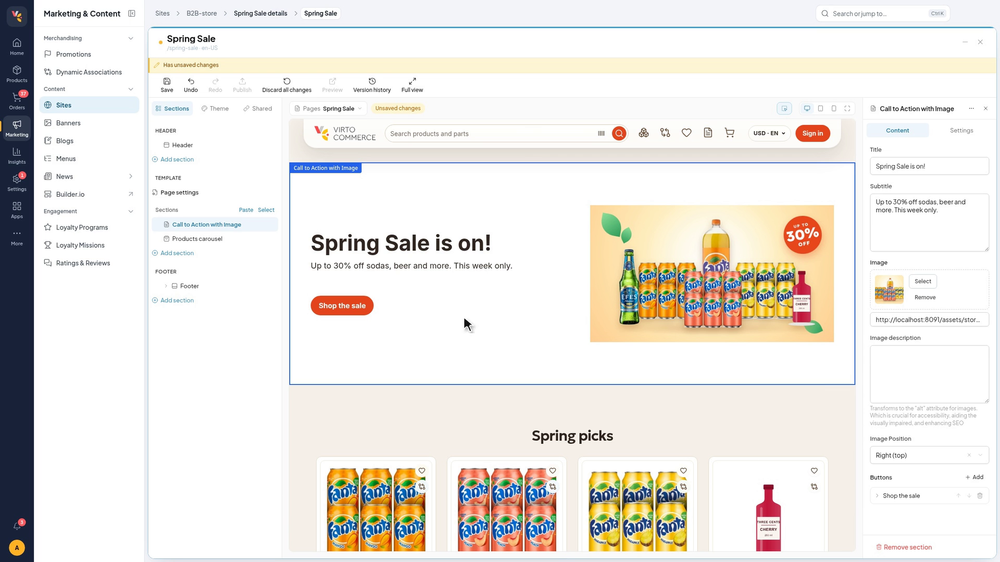
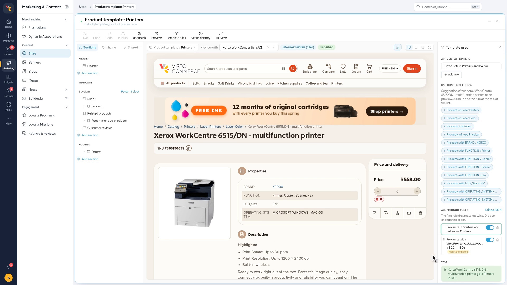
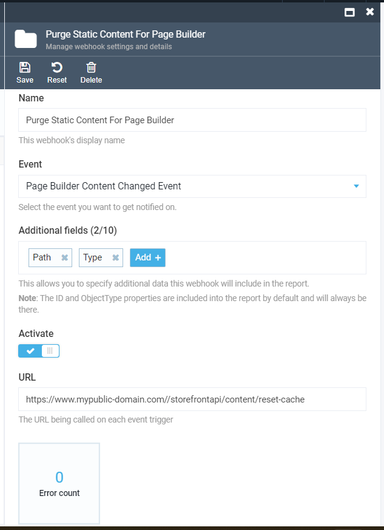

# Site Builder

Site Builder lets a merchandiser build the storefront's pages, catalog templates and theme in a visual designer, next to a live preview of the real storefront.

It replaces Page Builder ([vc-module-pagebuilder](https://github.com/VirtoCommerce/vc-module-pagebuilder)). The two cannot be installed together, and Site Builder uses Page Builder's database as it is, so existing pages stay after the switch.



## What it does
* **Pages from sections.** Landing pages, content pages and blog articles are built from sections: add, reorder, copy, paste and hide them, and edit their settings while the preview updates.
* **Catalog templates and rules.** Product, category and other storefront templates are edited the same way. Template rules decide which template a page gets, by category, product type or property, and the rule panel shows which rule a previewed product matches.
* **Theme.** Header, footer, light and dark palettes, logos and favicon. The palette generator builds both palettes from one or two brand colors, with every text and background pair at WCAG 2.2 AA contrast.
* **Theme publishing.** One action puts every theme draft live as a new versioned theme per language. A publication that fails validation leaves the previous one live.
* **Multilanguage pages,** with per-language values for translatable fields.
* **Version history on GitHub.** Each store can have its own repository: every save is a commit, any version can be restored, and pages can go live through a pull request.
* **AI assistant (Virto OZ)** generates, edits, diagnoses and bulk-updates pages from a text prompt. See [AI Assistant for Site Builder](docs/ai-assistant.md).
* **Admin Shell plugin and a standalone designer app.**

The store setting **New Site Builder** switches a store to the new designer; with it off, the store keeps the classic designer.



## Store access

A role can hold `builder:read` and `builder:shared-components:read` for selected stores only (the **Only for selected stores** scope). Every Site Builder endpoint checks the store it addresses: besides its own permission, the user needs the read permission in that store, for every store or through the scope. An account bound to a store reaches that store only.

The Vue designer lists a theme's alternate templates through the Content module's theme search (`GET api/content/themes/{storeId}/search`), so switching to one needs `content:read` as well; without it the template switcher offers only the default templates and says why.

## Shared Component creation

`POST /api/site-builder-shared-components` requires an existing store. An authorized request with an unknown `storeId` returns `400` naming that store, before any component, content, or asset references are written. Store-scoped authorization runs first; requests outside the user's store return `403`.

## Backup & Restore

Site Builder pages are included in the platform-wide backup and restore process.

When you run a platform export, all Site Builder pages (metadata and all variants including Draft, Published, and Archived) along with their JSON content are serialized into the backup archive.

On import, pages are recreated with new identifiers, preserving all metadata and content.

To run backup/restore:
1. Open Virto Commerce Admin UI.
1. Navigate to **Settings → Platform → Export** (or **Import**).
1. Ensure **Site Builder Module** is selected in the module list.
1. Run the export/import process.

## Concurrent page editing

Grouped-page content saves require the version the author originally read. `GET /api/site-builder-pages/grouped/{groupId}/content?draft=true` returns an `ETag`; send that exact value in `If-Match` when posting the edited document to the same URL. A successful save returns `204` and the next `ETag`. A stale version returns `412` without changing content or reference indexes. A missing version returns `428`; wildcard and weak tokens are rejected.

JSON clients can read `?draft=true&includeVersion=true` to receive `{ "content": "<page JSON>", "eTag": "<version>" }`, then post both fields to `/api/site-builder-pages/grouped/{groupId}/content-json`. An existing unseeded group has its own empty-state version: the raw GET returns `404` with an `ETag`, while the versioned GET returns a blank document and that token. A missing group has no token.

The Designer keeps local edits after a conflict and asks the author to copy them before reloading. Integrations must handle `412` the same way: read the new document and reapply the edit, rather than attach a fresh token to stale content. Update existing clients to send a version when upgrading the module. This contract covers grouped-page content editing; blob/theme content and Shared Component originals use their existing APIs.

### Upgrade notes

Grouped-page content POSTs now require a version. Deploy updated integrations together with this module. For proxies that transform HTTP ETag headers, use `includeVersion=true` on both GET and POST: GET returns `{ content, eTag }`, and a successful POST returns `200` with `{ eTag }`. The Designer uses these body tokens. Without that option, successful POSTs retain `204` plus the ETag header. An identical retry of an already accepted document succeeds with its current version, without a second persistence or index write.

`POST /api/site-builder-pages/create-group-page` requires a JSON object with a `content` array. The Shell import converts legacy top-level arrays to this object before submitting. Empty objects, legacy `{ pageContent: ... }` envelopes, null content, and sections without a type return `400`; empty or invalid JSON fails client parsing or server validation. Creation writes component and asset reference indexes in the same transaction as content. Add page also saves its initial settings and draft together.

The existing `IGroupedPageService` and `IContentStreamRepository` contracts remain unchanged. `IGroupedPageContentService` is registered separately in DI: the default registration uses a capable grouped service or the built-in authoring implementation, so existing grouped-service decorators keep working. Replacements that change authoring persistence should register this capability too. Customize Shell settings saves by overriding `SaveGroupSettingsAsync`; they no longer dispatch through a `SaveChangesAsync` override. Existing repository decorators can use the original queries, locks and asset-index method; `ISiteBuilderContentIndexRepository` is optional. Shell settings updates read the current document inside the same write lock; visibility-only updates preserve its bytes and version and do not create a draft when published content already exists.

Custom `builder_settings.json` descriptors replace the bundled descriptor as a whole. Theme overrides of grouped `templateUrl` and `saveGroupedPage` must retain `versioned: true` and `includeVersion=true` on their URLs. External unversioned backends keep their existing contract.

Closing the AI panel or receiving its `RELOAD_BLADE` message checks the current server version without replacing the local document's token. A changed, clean page reloads; a changed, dirty page keeps its edits and asks the author to reconcile. Unchanged pages produce no warning, and busy pages are left alone. Older assistants without save notifications are checked when their panel closes. Copy retains its newest Draft/Published source rule and rejects archived-only groups; publish and legacy direct content service calls retain their existing contracts.

## Getting started

### Prerequisites
1. Virto Commerce (`vc-platform`)  [Quick start](https://docs.virtocommerce.org/platform/developer-guide/)
1. Virto Frontend (`vc-frontend`).  [Deploy Frontend](https://docs.virtocommerce.org/storefront/developer-guide/deployment/)
1. Site Builder Module (`vc-module-site-builder`). [Download and Install](https://github.com/VirtoCommerce/vc-module-site-builder/releases).

### Setup Content
Check that Virto Commerce Platform and Storefront use same Shared Content folder.

### Setup Content Module
Content configuration should be extended with `PathMappings` section.

appsettings.json
```json
    "Content": {
        ...
        "PathMappings":{
            "pages": [
                "Themes",
                "_storeId",
                "_theme",
                "content/pages",
            ],
            "themes": [
                "Themes",
                "_storeId"
            ]
        }
        ...
    },
```

Environment Variables
```yaml
      Content__PathMappings__pages__0: "Themes"
      Content__PathMappings__pages__1: "_storeId"
      Content__PathMappings__pages__2: "_theme"
      Content__PathMappings__pages__3: "content/pages"
      Content__PathMappings__themes__0: "Themes"
      Content__PathMappings__themes__1: "_storeId"
```

### Setup Store
Public Store URL should be configured.


1. Open Virto Commerce Admin UI.
1. Select `Stores`.
1. Select Current Store.
1. Setup Store URL if it's empty
1. Click Save button to apply.

### Purge Cache
You can purge static page from storefront cache by event. Otherwise, you will need to wait for cache expiration.

Virto Storefront has `/storefrontapi/content/reset-cache` end point for static page invalidation.

We recommend using Webhooks module.

1. Install `vc-module-webhooks` module.
1. Open Virto Commerce Admin UI.
1. Select Webhooks module.
1. Click `Add` button in toolbar to create a new webhook subscription.
1. Enter webhook subscription name.
1. Select `Site Builder Content Changed Event` event in Events drop-down.
1. Select `Path` and `Type` in additional fields.
1. Turn on `Activate` checkbox.
1. Enter Storefront end point in URL. Ex: https://www.mypublic-domain.com//storefrontapi/content/reset-cache
1. Save webhook subscription.



### Run
1. Open Virto Commerce Admin UI.
1. Select Content module.
1. Find Store and Select Pages widget.
1. Click `Add` button in toolbar.
1. Select 'Design page'.
1. Provide page file name, public name and permalink. Ex: 'black-friday-2022', 'Black Friday 2022' and `blackfriday-2022`.
1. Click `Create` button

Now, you should be redirected to site builder application and you can create a first page.

Later, you can open and edit site builder pages, directly from content module.

## Site Builder Theme Structure
Site Builder reads meta-data from theme. Developers can extend or customize site builder behaviour by theme repository.

```text
├── client-app                    // The main folder for the application.
|   ├── shared                    // Assets needed to be precompiled during building.
|   |   └── static-content
|   |      └── components         // Vue Components for rendering Site Builder elements.
├── config
|   |   └── schemas               // All Site Builder meta information are stored here.
|   |      ├── blocks             // Block definitions.
|   |      |   └──...
|   |      ├── objects            // Object definitions.
|   |      |   └──...
|   |      ├── sections           // Sections definitions.
|   |      |   └──...
|   |      ├── shared             // Global settings folder.
|   |      |   └── _blocks.json   // Global settings for blocks.
|   |      |   └── _sections.json // Global settings for sections.
|   |      └── templates
|   |          └── page.json      // Site Builder configuration for static pages.
|   └── settings_schema.json      // Theme settings schema file. Site Builder uses it for Theme and Preset editor.
|   └── settings_data.json        // Theme config file.
```

## Notes

To enable the preview of your site within the Site Builder application, the site must allow itself to be displayed in an iframe. This can be achieved by setting the appropriate headers in your server configuration.

Add the following headers to your server configuration:

```http
Content-Security-Policy: "frame-ancestors 'self' https://localhost:5001;"
Cross-Origin-Resource-Policy: "cross-origin"
Cross-Origin-Embedder-Policy: "credentialless"
```

These headers ensure that the site can be embedded in an iframe and handle cross-origin requests appropriately.

## Documentation

* [PageBuidler module user documentation](https://docs.virtocommerce.org/platform/user-guide/page-builder/overview/)
* [AI Assistant for Site Builder (Virto OZ)](docs/ai-assistant.md)
* [REST API](https://virtostart-demo-admin.govirto.com/docs/index.html?urls.primaryName=VirtoCommerce.SiteBuilder)
* [View on GitHub](https://github.com/VirtoCommerce/vc-module-site-builder)

## References

* [Deployment](https://docs.virtocommerce.org/platform/developer-guide/Tutorials-and-How-tos/Tutorials/deploy-module-from-source-code/)
* [Installation](https://docs.virtocommerce.org/platform/user-guide/modules-installation/)
* [Home](https://virtocommerce.com)
* [Community](https://www.virtocommerce.org)
* [Download latest release](https://github.com/VirtoCommerce/vc-module-site-builder/releases/latest)

## License
Copyright (c) Virto Solutions LTD. All rights reserved.

Licensed under the Virto Commerce Open Software License (the "License"); you may not use this file except in compliance with the License. You may obtain a copy of the License at

http://virtocommerce.com/opensourcelicense

Unless required by applicable law or agreed to in writing, software distributed under the License is distributed on an "AS IS" BASIS, WITHOUT WARRANTIES OR CONDITIONS OF ANY KIND, either express or implied.
