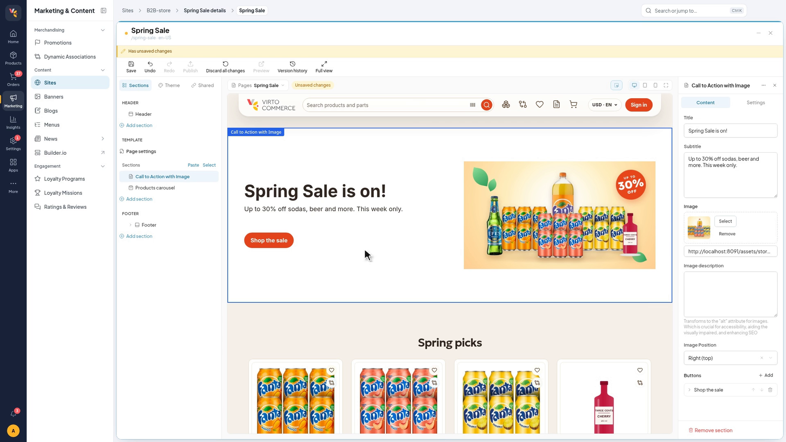
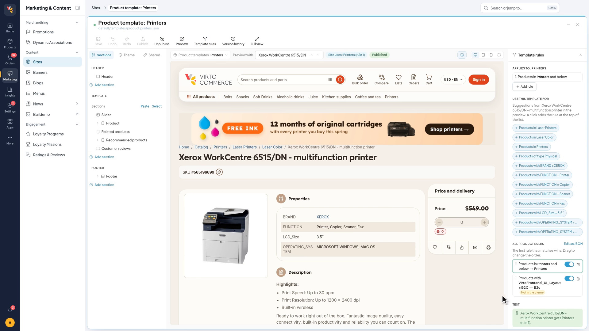

# Site Builder (Beta)

> **Beta.** Site Builder is ready to try and its storage stays compatible with Page Builder, but its APIs and theme formats may still change before the first stable release.

Site Builder lets a merchandiser build the storefront's pages, catalog templates and theme in a visual designer, next to a live preview of the real storefront.

It replaces Page Builder ([vc-module-pagebuilder](https://github.com/VirtoCommerce/vc-module-pagebuilder)). The two cannot be installed together, and Site Builder uses Page Builder's database as it is, so existing pages stay after the switch.



## What it does
* **Pages from sections.** Landing pages, content pages and blog articles are built from sections: add, reorder, copy, paste and hide them, and edit their settings while the preview updates.
* **Catalog templates and rules.** Product, category and other storefront templates are edited the same way. Template rules decide which template a page gets, by category, product type or property, and the rule panel shows which rule a previewed product matches.
* **Theme.** Header, footer, light and dark palettes, logos and favicon. The palette generator builds both palettes from one or two brand colors, with every text and background pair at WCAG 2.2 AA contrast.
* **Theme publishing.** One action puts every theme draft live as a versioned theme per language. A publication that fails validation leaves the previous one live.
* **Multilanguage pages,** with per-language values for translatable fields. See [Multilanguage Pages](docs/multilanguage-pages.md).
* **Version history on GitHub.** Each store can have its own repository: every save is a commit, any version can be restored, and pages can go live through a pull request. See [Version history](docs/version-history.md) and [Sites on GitHub](docs/sites-on-github.md).
* **AI assistant (Virto OZ)** generates, edits, diagnoses and bulk-updates pages from a text prompt. See [AI Assistant for Site Builder](docs/ai-assistant.md).
* **AI agents (MCP).** With the MCP module, Claude, ChatGPT or any MCP client works on pages, templates and the theme through the same checks as the designer. See [AI agents (MCP)](#ai-agents-mcp).



## Requirements

* **Storefront.** vc-frontend with the theme snapshot and preview protocol 2 ([VCST-6572](https://virtocommerce.atlassian.net/browse/VCST-6572)), and `"site_builder_enabled": true` in its `client-app/config/settings_data.json`. A platform whose storefront lacks them stays on the Page Builder module.
* **Modules.** The dependencies in `module.manifest`, among them Content, XCMS and xAPI. The **Pages** module (`VirtoCommerce.Pages`) is optional: it indexes database pages, so the storefront finds them by their address.
* **Preview.** The designer shows the storefront in a frame. Its address is the global setting `SiteBuilder.General.StoreUrl`, or else the store's secure URL, or else its URL, followed by `SiteBuilder.General.StorePreviewPath` (`/designer-preview` by default). The storefront must let the platform's origin frame it:

  ```http
  Content-Security-Policy: frame-ancestors 'self' https://<platform>
  ```

* **Pages stored as files** live in `Pages/{storeId}/` of the content storage by default. To edit the pages a vc-frontend theme ships in its `content/pages` folder, point the Content module's `pages` path there:

  ```json
  "Content": {
    "PathMappings": {
      "pages": [ "Themes", "_storeId", "_theme", "content/pages" ]
    }
  }
  ```

## Switching from Page Builder

On its first start, Site Builder copies Page Builder's settings to its own names in a background job:

* the global settings `StoreUrl`, `StorePreviewPath` and `OzAgentUrl`;
* each store's `PreviewUserIds`, `GitContentEnabled` and `GitContentRepository`;
* the saved GitHub App connection, encrypted again for Site Builder.

A setting that already has a stored Site Builder value keeps it. The copy runs once: if you later switch back to Page Builder and then to Site Builder again, Site Builder keeps its own values. If this server cannot decrypt the GitHub App connection (its data protection keys were not kept), the log has a warning naming the setting, and the connection has to be set up again.

The `PageBuilder:GitContent` and `PageBuilder:ThemeSnapshot` configuration sections (`PageBuilder__…` environment variables included) and the `VirtoCommerce.PageBuilderModule` connection string still work when the Site Builder name is not set. They are deprecated, and a warning at startup lists them: rename them to `SiteBuilder:…` and `VirtoCommerce.SiteBuilder`.

Roles keep working: the permissions are the same `builder:*` ones.

Settings forced in configuration under `VirtoCommerce:Settings:Override` need a manual step: they are keyed by setting name, so rename `VirtoCommerce.PageBuilderModule.*` to `VirtoCommerce.SiteBuilder.*`.

## Getting started

1. **Install** Site Builder in **Modules** of the back office, in place of Page Builder if it is installed. [Switching from Page Builder](#switching-from-page-builder) tells what carries over.
2. **Open the designer.**
   * Admin Shell: **Sites**, a store, the **Pages** tab: **New page** creates a page, and a page in the list opens in the designer. The store's **Site Builder** widget opens the store's page list, where **Add** creates a Landing Page, or a Multilanguage Page when the store has more than one language.
   * Classic Manager: **Content**, a store, **Pages**, **Add**, **Design page** creates a page stored as a file (file name, language and permalink) and opens it in the designer in a new tab. The store's **Site Builder** widget opens the designer for the store.
3. **Edit and publish.** **Save** keeps the changes as a draft, which the preview shows; **Publish** puts the draft live. Publishing the theme puts every theme draft live together.

### How published content reaches the storefront

* **Database pages** (Landing and Multilanguage Pages). With the Pages module, a page is indexed at once on publication. The storefront finds it by its address (`slugInfo`) and reads it through xAPI (`pageDocument`); there is no cache to clear.
* **Theme.** The storefront reads the published theme through `themeSnapshot`. The platform caches it, and a theme publication clears that cache on every instance.
* **Pages stored as files.** The Content module indexes them. A new or renamed file page is found by its address once the Content module indexes it again.

## Store access

A role can hold `builder:read`, `builder:shared-components:read` and `builder:preview-as` for selected stores only (the **Only for selected stores** scope). Every Site Builder endpoint checks the store it addresses: besides its own permission, the user needs the read permission in that store, for every store or through the scope. An account bound to a store reaches that store only.

`builder:preview-as` lets an editor preview pages as one of the store's preview users (the store setting **Preview user IDs**), in the stores the role holds it for: the preview code endpoint checks it in the store in place of the read permission. Only customer accounts can be previewed: an administrator or a manager listed there is refused.

The Vue designer lists a theme's alternate templates through the Content module's theme search (`GET api/content/themes/{storeId}/search`), so switching to one needs `content:read` as well; without it the template switcher offers only the default templates and says why.

## AI agents (MCP)

The module adds a Site Builder toolset to the back-office MCP endpoint of the [MCP module](https://github.com/VirtoCommerce/vc-module-mcp), `/admin/mcp`. It is for two kinds of work:

* **The content author**, a marketer or content manager: landing pages, content pages, translations, SEO, and who sees a page.
* **The site designer**, who owns how the site looks: product, category and page templates, the rules that choose a template, header, footer, brand and palette.

They ask an AI agent (Claude, ChatGPT, VS Code or any MCP client) in plain words, and the agent works through the same checks as the designer: the store access of the user, page and theme validation, drafts and version history. Customers see nothing an agent publishes until a second person approves it.

### Features

- **Orientation.** One call tells what a store's site holds: pages by status and language, what waits for publication, recent changes with who made them, translation coverage, the theme's drafts, and whether history and the schema catalog are available.
- **Pages from a request.** Create a landing page with its sections, or as a copy of another page; edit sections, blocks, texts, SEO and layout of a draft; place and detach Shared Components.
- **Languages.** Turn a landing page into a Multilanguage Page, link and unlink language versions, create the missing ones and fill them with translations bound to the version of the source they were made from.
- **Content gaps.** Missing and outdated translations and pages without an SEO title or description, as findings with evidence and a fix.
- **Bulk changes.** One change of a section on every page that matches a filter, and translations of many pages, run as background jobs.
- **Templates and theme.** Create and edit templates, reorder, enable and disable template rules, edit the header, footer and brand, and generate the light and dark palette from brand colors with a contrast check.
- **Before publishing.** What a publication would put live, who changed each part, what would refuse it, and who would see it, from the dry run of the publication itself.
- **Safe changes.** Every change has a dry run. Publishing a page or the theme, and changing what a published page shows or who sees it, wait for a second person's approval. Restoring a version and discarding a draft ask the user to confirm.

### Quick setup

To try the toolset with Claude Code, Claude Desktop or claude.ai and one administrator account:

1. **Install the modules** in **Modules** of the back office: Site Builder, the [MCP module](https://github.com/VirtoCommerce/vc-module-mcp) and Background Jobs (`VirtoCommerce.BackgroundJobs`). Background Jobs runs the bulk tools, `update_sections_bulk` and `set_translations`; without it they answer that jobs are not available and change nothing. Without the MCP module, Site Builder works as before and serves no tools.
2. **Open the endpoint** in `appsettings.json`, then restart the platform. Without `MCP:PublicOrigin` the endpoint refuses every token with `invalid_token`.

   ```json
   "Authorization": { "Resources": [ "https://<platform>/admin/mcp" ] },
   "MCP": { "PublicOrigin": "https://<platform>" }
   ```

3. **Connect the agent** to `https://<platform>/admin/mcp`, sign in with the back-office account and allow access. These agents register themselves, so no OAuth application is needed.
   - Claude Code: `claude mcp add --transport http virto https://<platform>/admin/mcp`, then `/mcp` → **Authenticate**.
   - Claude Desktop or claude.ai: **Settings → Connectors → Add custom connector** with the endpoint URL.
4. **Let the account approve its own changes**: set the MCP module's setting `MCP.Approval.AllowSelfApproval` to true, and approve publications in **Agent approvals**. An administrator has every permission the tools need.

The agent works as the signed-in user and sees only the tools that user's permissions allow.

### Production setup

**Roles.** Give the content author and the site designer roles with the permissions their work needs. Every tool needs `builder:read` in the store it works in. `builder:read` and `builder:shared-components:read` may be limited to some stores (**Only for selected stores**); the agent then reads and changes those stores only, as in the designer.

| Permission | Gives |
| --- | --- |
| `builder:read` | Every read tool, the prompts, and the schema and rule-condition resources, in the stores it covers |
| `builder:update` | Editing page drafts, page settings, language links, translations, bulk changes, restoring versions and discarding drafts |
| `builder:create` | `create_page`; with `builder:update`, `convert_page_to_multilanguage` |
| `builder:publish` | `publish_page`, `unpublish_page` and `publish_theme`, as requests for approval |
| `builder:templates` | With `builder:update`: `edit_template` and `edit_template_rules` |
| `builder:theme` | With `builder:update`: `edit_theme_draft` |
| `builder:shared-components:read`, `:create`, `:update` | `search_shared_components`; with it, `create_shared_component` and `change_shared_component` |
| `platform:asset:read` | `search_assets` |
| `platform:setting:read` | The store settings and user groups resources |
| `customer:read` | The organizations resource, granted for every organization |
| `mcp:approve` | Approving publications and changes of published pages in **Agent approvals** |

**Approvers.** Give `mcp:approve` to another role than the people who ask for changes, and keep `MCP.Approval.AllowSelfApproval` off.

**Other agents.** ChatGPT, VS Code and other agents that do not register themselves need an OAuth application in **Security → OAuth applications**, as the MCP module's [Set up the platform for agents](https://github.com/VirtoCommerce/vc-module-mcp#set-up-the-platform-for-agents) describes; their users enter its client id. [Connect an AI agent](https://github.com/VirtoCommerce/vc-module-mcp#connect-an-ai-agent) has the steps for each agent.

### Tools

| Layer | Tool | What it does | Permission | Safeguard |
| --- | --- | --- | --- | --- |
| Orientation | `get_site_overview` | Start here: pages, drafts, recent changes, language coverage, theme state, history, schema catalog and publication flow of a store or of every store you read | `builder:read` | — |
| Search | `search_site_pages` | Pages from the database and, per store and folder, pages stored as files: the list, one page with its sections and version token, or the pages that use a section type | `builder:read` | — |
| Search | `search_templates` | Templates, their drafts, the rules that give them pages, and every rule in order | `builder:read` | — |
| Search | `search_assets` | Images and files of a folder with their public links, and where they are used | `platform:asset:read` | — |
| Search | `search_shared_components` | Shared Components, their content and the pages they are placed on | `builder:shared-components:read` | — |
| Search | `list_versions` | Saved versions of a page or of theme files, from the store's GitHub history; the commits of a page stored as a file in git | `builder:read` | — |
| Analysis | `get_preview` | A storefront link to a draft or a version, and which template and rule a page, product pages or category pages get | `builder:read` | — |
| Analysis | `find_content_gaps` | Missing and outdated translations, pages without SEO title or description | `builder:read` | — |
| Analysis | `get_publish_readiness` | What a page or theme publication would put live, who changed it, what blocks it, who sees it | `builder:read` | — |
| Content | `create_page` | A landing page with sections or as a copy, a missing language version, a copy of a Multilanguage Page | `builder:create` | Dry run |
| Content | `edit_page_draft` | Sections, blocks, texts, SEO, layout and Shared Components of a draft; a database page holds one text per setting, its language versions hold the others | `builder:update` | Dry run, version token |
| Content | `change_page_settings` | Name, language, address, audience and dates | `builder:update` | Approval bound to the reviewed versions, of every language version a Multilanguage Page change reaches; none with `unpublished_only` for a page never published |
| Content | `convert_page_to_multilanguage` | A landing page becomes a Multilanguage Page | `builder:create`, `builder:update` | Approval bound to the reviewed versions; none with `unpublished_only` for a page never published |
| Content | `link_page_language`, `unlink_page_language` | A page becomes a language version, or a landing page again | `builder:update` | Approval bound to the reviewed versions; none with `unpublished_only` for a page never published |
| Content | `reset_language_overrides` | Language versions take the values of the Multilanguage Page again | `builder:update` | Approval bound to the reviewed versions; none with `unpublished_only` when no version is published |
| Content | `publish_page`, `unpublish_page` | Publish a draft, or take a page off the storefront; in git the requester's own draft branch is shipped | `builder:publish` | Approval bound to the reviewed versions (of a database page: its draft and its settings) and, in git, the draft owner |
| Content | `restore_version` | A saved version of a page or of theme files becomes the draft | `builder:update` and the part's permission | Confirmation, expected versions |
| Content | `discard_draft` | Drop the draft of a page or of a theme file | `builder:update` and the part's permission | Confirmation, expected versions |
| Bulk | `set_translations` | Translations of many pages, bound to the source version | `builder:update` | Background job, dry run |
| Bulk | `update_sections_bulk` | One change of a section on every page of a filter; the pages are fixed when the job is queued | `builder:update` | Background job, dry run |
| Design | `edit_template` | Create a template as a copy, edit its sections and layout; the main section stays, and only sections the designer offers for the template go in | `builder:update`, `builder:templates` | Dry run, version token |
| Design | `edit_template_rules` | Add, change, reorder, enable or disable rules; a rule points to an existing template only | `builder:update`, `builder:templates` | Dry run, version token |
| Design | `edit_theme_draft` | Header, footer, brand, and a palette generated from brand colors with a contrast check | `builder:update`, `builder:theme` | Dry run, version token |
| Design | `publish_theme` | Publish every theme draft; refused when the palette, the header icons or a section's own colors fall below WCAG 2.2 AA contrast | `builder:publish` | Approval bound to the reviewed drafts |
| Shared Components | `create_shared_component` | A new component, not placed anywhere yet | `builder:shared-components:create` | Dry run |
| Shared Components | `change_shared_component` | New content or name; the content changes everywhere the component is placed | `builder:shared-components:update` | Approval bound to the reviewed content when the content changes |

Bulk jobs are followed with the MCP module's `get_job_status`. Tool calls are audited by the MCP module, and **Agent tools** switches any of them off.

### Prompts and resources

MCP clients show the prompts as slash commands, for example `/mcp__virto__weekly_content_review` in Claude Code. Review prompts change nothing and ask before any action.

| Prompt | For | What it does |
| --- | --- | --- |
| `weekly_content_review` | Content author | What waits for publication, what changed this week, what is missing, with a short action list |
| `launch_landing_page` | Content author | From a brief to a landing page draft, its preview and its publication check |
| `translate_site` | Content author | Missing and outdated translations of a language, created and translated once you agree |
| `review_template_rules` | Site designer | Which template each kind of page gets, rules that never fire or point nowhere |
| `rebrand_site` | Site designer | Palette from a brand color, logos, header and footer, up to the theme's publication check |
| `review_theme_release` | Site designer | Every draft the theme's publication would take, who changed it, and what blocks it |
| `review_site_change` | Approver | What a requested change would do, who made it, and what to check before approving |

| Resource | What it holds | Permission |
| --- | --- | --- |
| `site-builder://stores/{store_id}/schemas` | Section, block, object and template types the storefront sent; not available until the storefront has sent its catalog | `builder:read` |
| `site-builder://stores/{store_id}/schemas/{kind}/{key}` | One schema with its settings | `builder:read` |
| `site-builder://template-rule-conditions` | The conditions a template rule can use, and the shape of their values | `builder:read` |
| `site-builder://stores/{store_id}/settings` | Languages, time zone and publication flow (git or blob) of a store | `builder:read`, `platform:setting:read` |
| `site-builder://user-groups` | User groups a page's audience can name, paged | `builder:read`, `platform:setting:read` |
| `site-builder://organizations` | Organizations a page's audience can name, by keyword, paged | `builder:read`, `customer:read` |

### What agents cannot do

These stay in the designer or with an administrator, on purpose:

- Delete or archive pages, or delete an empty Multilanguage Page: it cannot be undone.
- Delete Shared Components: it takes effect at once on every page.
- Promote content to the production branch of a store's repository (`builder:promote`).
- Upload, overwrite or delete assets and asset folders.
- Connect a store to GitHub, install the GitHub App, or clean up old drafts.
- Preview the storefront as another user: it needs `loginOnBehalf`.
- Check links to deleted products and categories, or section settings against the schemas: `find_content_gaps` says these are not checked, and why.
- Publish anything, or change what customers see, without a second person's approval.

## For integrators

### Page content and versions

Grouped-page content saves require the version the author read. `GET /api/site-builder-pages/grouped/{groupId}/content?draft=true` returns an `ETag`; send that exact value in `If-Match` when posting the edited document to the same URL. A successful save returns `204` and the next `ETag`. A stale version returns `412` without changing content or reference indexes. A missing version returns `428`; wildcard and weak tokens are refused.

JSON clients can read `?draft=true&includeVersion=true` to receive `{ "content": "<page JSON>", "eTag": "<version>" }`, then post both fields to `/api/site-builder-pages/grouped/{groupId}/content-json`; a successful post returns `200` with `{ eTag }`. Use this form behind proxies that change HTTP `ETag` headers. An existing group without content has its own empty-state version: the raw GET returns `404` with an `ETag`, the versioned GET a blank document and that token. A missing group has no token. An identical retry of an accepted document succeeds with its current version, without a second write.

The designer keeps local edits after a conflict and asks the author to copy them before reloading. Integrations handle `412` the same way: read the new document and apply the edit again, rather than attach a fresh token to stale content.

`POST /api/site-builder-pages/create-group-page` takes a JSON object with a `content` array. Empty objects, `{ pageContent: ... }` envelopes, null content and sections without a type return `400`. A page is created with its settings, draft, and component and asset reference indexes in one transaction.

`POST /api/site-builder-shared-components` requires an existing store. Store access is checked first: a request outside the user's stores returns `403`. An authorized request with an unknown `storeId` returns `400` naming that store, before anything is written.

The REST API is in the platform's Swagger UI (`/docs`), under `VirtoCommerce.SiteBuilder`.

### Extending

* `IGroupedPageContentService` is registered separately from `IGroupedPageService`. The default registration uses a grouped-page service that implements it, or the built-in authoring implementation, so decorators of `IGroupedPageService` keep working. A replacement that changes how page content is stored registers `IGroupedPageContentService` too.
* Settings saves from the Admin Shell go through `SaveGroupSettingsAsync`; override it to customize them. They read the current document inside the same write lock, and a visibility-only change keeps the document and its version.
* `ISiteBuilderContentIndexRepository` is optional: repository decorators can keep the original queries, locks and asset index method.
* Site Builder publishes `SiteBuilderContentChangedEvent` when it writes a page file or a theme file, and changed events for its pages (`GroupedSiteBuilderPageChangedEvent`, `SiteBuilderPageChangedEvent`) and Multilanguage Pages (`MultilanguagePageChangedEvent`).

### Backup and restore

The platform export and import include Site Builder's database pages with every version (Draft, Published, Archived) and their content, Multilanguage Pages and Shared Components. Import keeps the exported ids and overwrites existing pages with the same ids. Pages stored as files and the theme live in the content storage (and in GitHub when a store uses it), so they are not part of the export.

To export or import, open **Settings → Platform → Export** (or **Import**) in the back office, select **Site Builder**, and run it.

## For theme developers

Site Builder works with a vc-frontend theme in three places:

* **Schemas and components** are part of the storefront build. Section, block, object and template schemas live in vc-frontend's `client-app/plugins/builder-preview/schemas/`; the components that render sections are registered in `client-app/shared/static-content/components/index.ts`.
* **The schema catalog.** In the designer's preview the storefront sends its catalog: schemas, palette tokens, template rule conditions and built-in templates. The designer stores it in the theme's `catalogs/` folder, and the server validates and cleans page content against it. The MCP schema resources read it too.
* **Theme state** that the designer edits is kept in the theme folder of the content storage (`Themes/{storeId}/{theme}/`):

  ```text
  config/settings_data.json         theme settings
  config/brand.json                 logos and favicon
  config/palette.json               light palette
  config/palette.dark.json          dark palette
  config/template_rules.json        template rules
  templates/                        catalog and page templates
  sections/header-group.json        header
  sections/footer-group.json        footer
  catalogs/                         schema catalogs the storefront sent
  snapshots/                        published themes, per language
  ```

The [preview protocol](docs/contracts/preview-protocol.md) and the [theme snapshot](docs/contracts/theme-snapshot.md) describe what passes between the designer, the platform and the storefront; the [history API](docs/contracts/history-api.md) covers version history.

## Documentation

* [Multilanguage Pages](docs/multilanguage-pages.md)
* [Version history](docs/version-history.md) and [Sites on GitHub](docs/sites-on-github.md)
* [AI Assistant for Site Builder (Virto OZ)](docs/ai-assistant.md)
* Contracts: [preview protocol](docs/contracts/preview-protocol.md), [theme snapshot](docs/contracts/theme-snapshot.md), [history API](docs/contracts/history-api.md)
* [Module installation](https://docs.virtocommerce.org/platform/user-guide/modules-installation/) and [deploying a module from source](https://docs.virtocommerce.org/platform/developer-guide/Tutorials-and-How-tos/Tutorials/deploy-module-from-source-code/)
* [Latest release](https://github.com/VirtoCommerce/vc-module-site-builder/releases/latest)

## License
Copyright (c) Virto Solutions LTD. All rights reserved.

Licensed under the Virto Commerce Open Software License (the "License"); you may not use this file except in compliance with the License. You may obtain a copy of the License at

http://virtocommerce.com/opensourcelicense

Unless required by applicable law or agreed to in writing, software distributed under the License is distributed on an "AS IS" BASIS, WITHOUT WARRANTIES OR CONDITIONS OF ANY KIND, either express or implied.
