# Block Library

These are the sections the Virto Frontend offers on a page in the Site Builder designer, under **Add section**. The pictures show them on a storefront with its own theme palette. Every section also has the shared settings on its **Settings** tab: an anchor to link to it, and a background.

Catalog templates add their own sections: **Product**, **Customer reviews**, **Related products** and **Recommended products** on product templates, and **Product listing** on category templates. The header and footer of the theme are sections too: **Announcement bar**, **Header** and **Footer**.

## Title

A title with a subtitle. The heading level is H2 to H6.

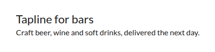

## Call to Action

A title and a row of buttons, each with a label and a link.

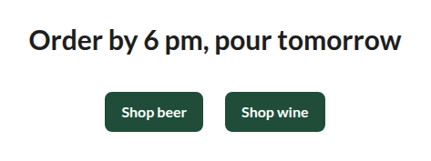

## Call to Action with Image

A title, a subtitle and an image, on the right or on the left, with the image's alternative text.

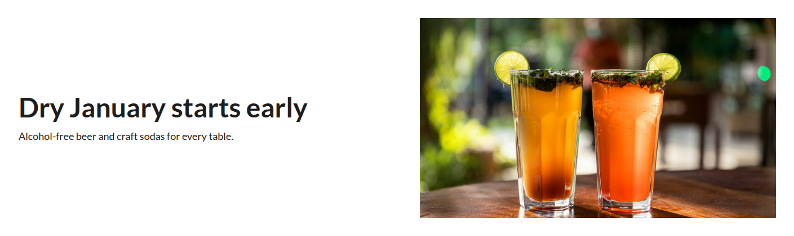

## Features

A title, a subtitle and a list of features, each with a title, a text and an image.

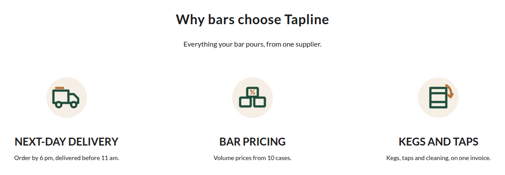

## Image

One image with its alternative text.

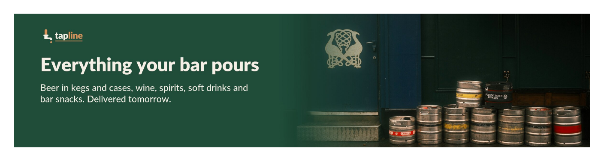

## Slider

Slides that change in turn, each with an image, a title, a text and a link. The slide height is automatic, small, medium or large.

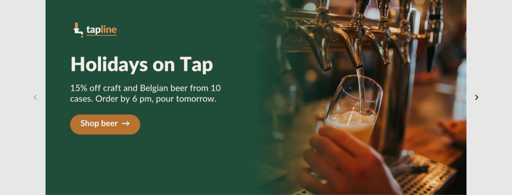

## Image carousel

A title, a subtitle and a set of images that scroll in turn.

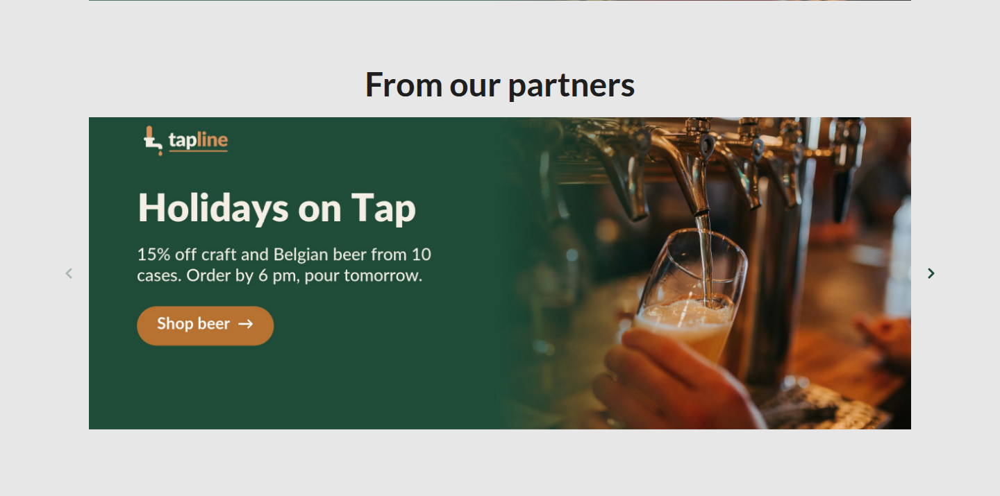

## Products

A title, a subtitle and a number of products that match a keyword.

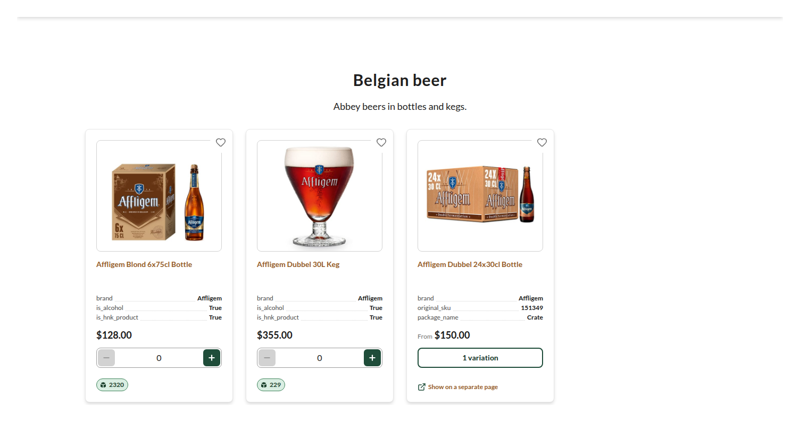

## Products carousel

Products that match a keyword, or the products of a list of SKUs, in a carousel with a set number of cards per view. Cards are full or short.

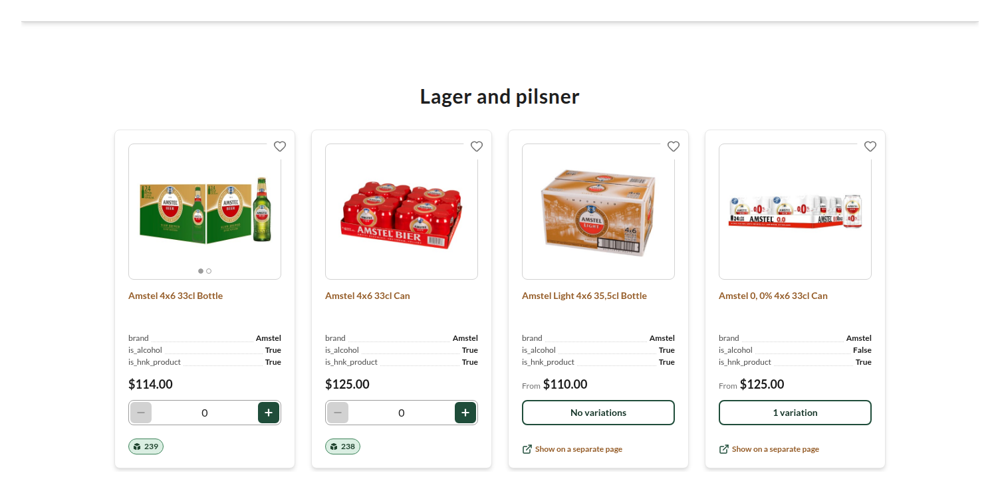

## Predefined products

The products of a list of SKUs.

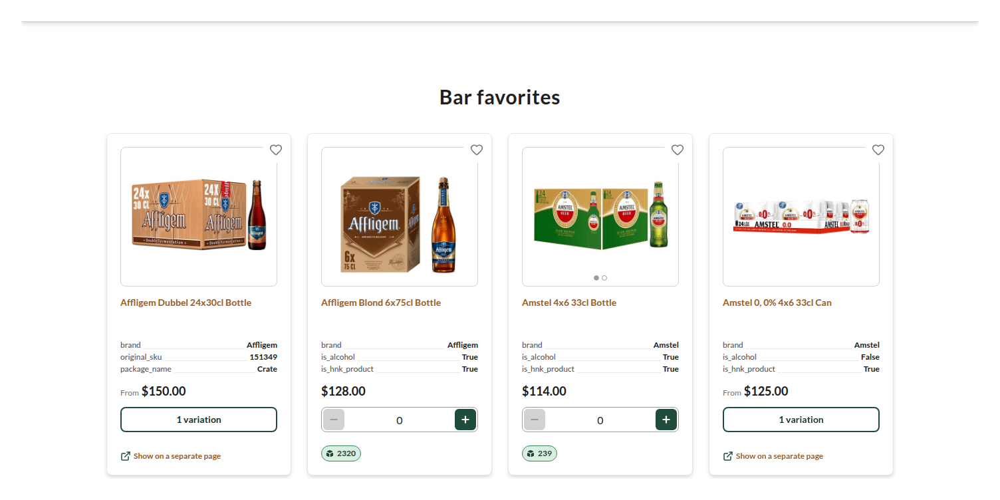

## Text

A title and a text written in Markdown.

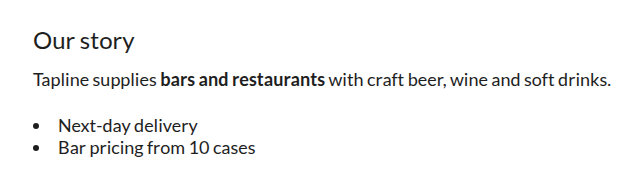

## Subscribe form

A title, a subtitle, an email field with its placeholder, a consent checkbox with a rich-text label, and a button.

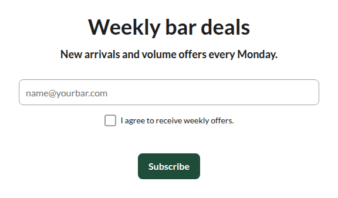

## Login

The storefront's sign-in form.

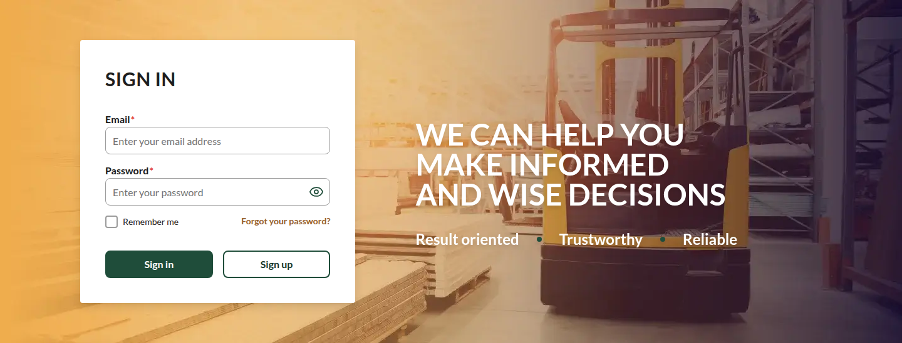

## Category

The product list of a category, or of a keyword, with the storefront's filters, sorting and view mode. Each part of the listing can be hidden.

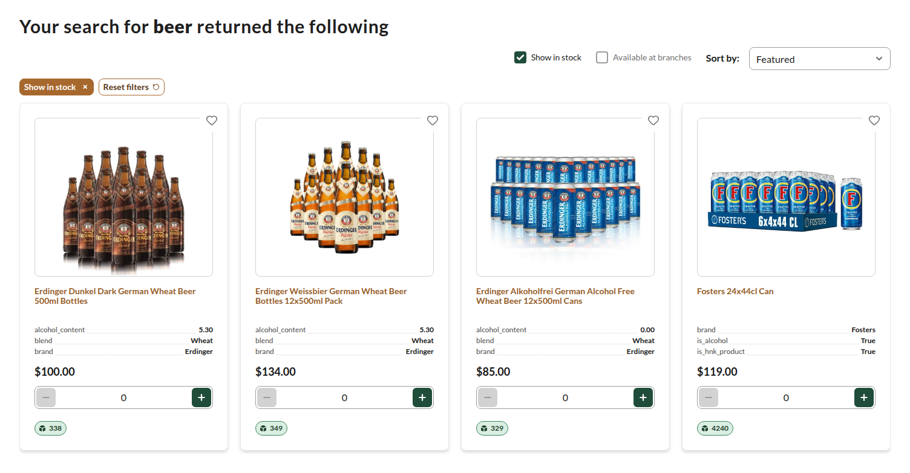

## FavoriteProducts

Products that match a keyword and a filter, in a grid or a list, with a title and a subtitle in their own colors and a background color or image.

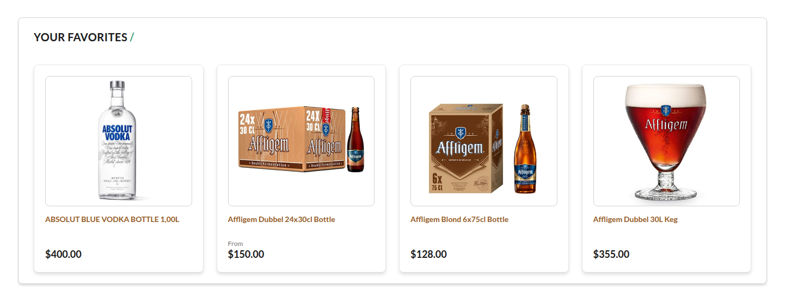

## Page Header

The page's SEO information: its title, keywords and description. It always stays at the top of the section list.

 
 
********

    <a href="../create-new-block">← Create new block </a>
    <a href="../schemas">Schemas →</a>

