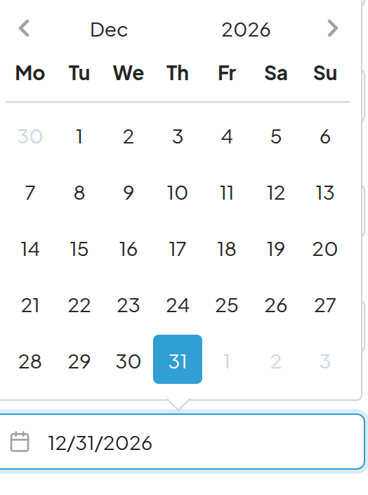

# Calendar Control Descriptor

This control allows users to select a date with the browser's date picker. The value is the date as a `YYYY-MM-DD` string, or `null` when the date is cleared. A stored date and time value is shown by its date.

{: width="300" }

## Example

```json
...
    "settings": [
        {
            "id": "date",
            "label": "Date",
            "type": "calendar",
            "info": "You can select date in calendar"
        },
        ...
    ]
...
```

<br>
<br>
********

<div style="display: flex; justify-content: space-between;">
    <a href="../../schemas">← Schemas </a>
    <a href="../checkbox">Checkbox →</a>
</div>