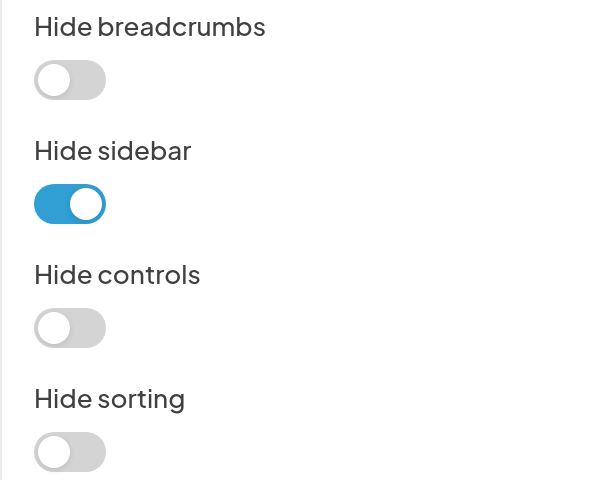

# Checkbox Control Descriptor

This control represents a simple toggle (checked or unchecked). No additional configuration options are required.

{: width="300" }

## Example

```json
...
    "settings": [
        {
            "id": "displayHeader",
            "label": "Display header",
            "type": "checkbox",
            "info": "You can display additional info",
            "default": true
        },
        ...
    ]
...
```


<br>
<br>
********

<div style="display: flex; justify-content: space-between;">
    <a href="../calendar">← Calendar </a>
    <a href="../list">Collection →</a>
</div>