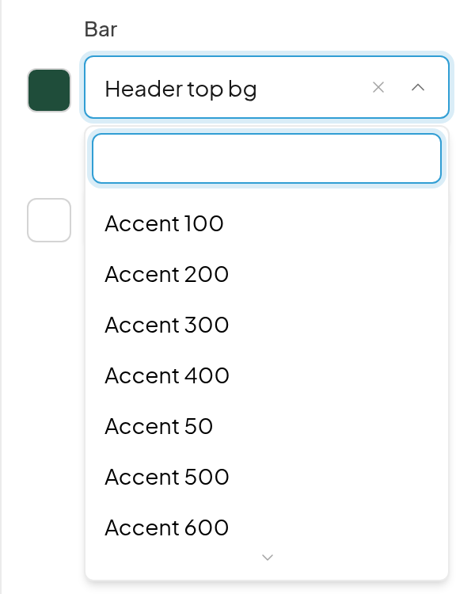

# Color Token Control Descriptor

This control picks a color of the theme palette by its token, such as `color_primary_500`, instead of a fixed color. The section then follows the palette: when the palette changes, or the storefront shows its dark palette, the color changes with it. The swatch next to the field shows the token's color in the current palette.

{: width="300" }

The tokens come from the storefront's schema catalog (`paletteTokens`). A value that is not one of them is listed as an unknown token, so it can be replaced.

| Property   | Type    | Description                                               |
| ---------- | ------- | --------------------------------------------------------- |
| `default`  | string  | The token used until another one is picked.              |
| `required` | boolean | `true` hides the clear button, so a token is always set. |

## Example

```json
...
    "settings": [
        {
            "id": "background",
            "label": "Bar",
            "type": "color-token",
            "default": "color_neutral_900"
        },
        {
            "id": "color",
            "label": "Text",
            "type": "color-token",
            "default": "color_additional_50"
        },
        ...
    ]
...
```

Theme publication checks the contrast of a section's own `color` on its `background` token in both palettes, as the palette check does for the theme.


<br>
<br>
********

<div style="display: flex; justify-content: space-between;">
    <a href="../color">← Color </a>
    <a href="../files">Files →</a>
</div>
