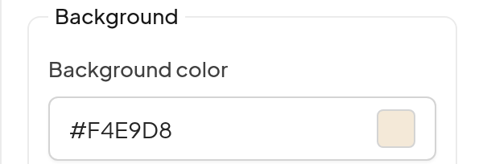

# Color Control Descriptor

This control provides a text field for a color value and a swatch that opens the browser's color picker. The picker writes the color as a hex value. The value is a string, or `null` when the field is cleared. No additional configuration options are required.

{: width="300" }

## Example

```json
...
    "settings": [
        {
            "id": "headerColor",
            "label": "Header color",
            "type": "color"
        },
        ...
    ]
...
```


<br>
<br>
********

<div style="display: flex; justify-content: space-between;">
    <a href="../list">← Collection </a>
    <a href="../color-token">Color token →</a>
</div>