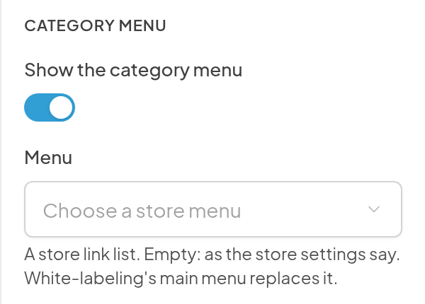

# Header Control Descriptor

This control displays a heading inside the editor panel.

{: width="300" }

| Property  | Description                          |
| --------- | ------------------------------------ |
| `label`   | Text to display in the editor panel. |

## Example

```json
...
    "settings": [
        {
            "type": "header",
            "label": "Please upload an image of reasonable size"
        },
        ...
    ]
...
```

<br>
<br>
********

<div style="display: flex; justify-content: space-between;">
    <a href="../files">← Files </a>
    <a href="../images">Images →</a>
</div>