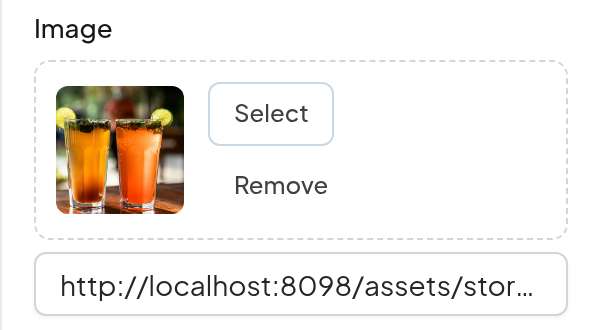

# Images Control Descriptor

This control functions similarly to the [files control](files.md), but with a default `accept` value set to `image/*`, and it shows a preview of the image.

{: width="300" }

## Example

```json
...
    "settings": [
        {
            "id": "image",
            "label": "Image",
            "type": "images",
            "default": "/themes/assets/blocks/portfolio.png"
        },
        ...
    ]
...
```

<br>
<br>
********

<div style="display: flex; justify-content: space-between;">
    <a href="../header">← Header </a>
    <a href="../markdown">Markdown →</a>
</div>