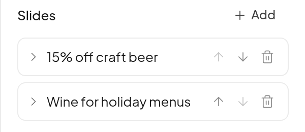

# Collection Control Descriptor

This control allows the user to manage a list of repeatable items, each defined by its own set of nested fields. The **Add** button adds an item with the default values of its fields. Items can be moved up and down and removed.

{: width="300" }

| Property                 | Type                  | Description                                                          |
| ------------------------ | --------------------- | -------------------------------------------------------------------- |
| `displayField`           | string                | Property name used to display a collection item in the list.<br>A dotted path, such as `product.name`, reads a nested value. Without it, the first filled `string` field is used. |
| `element`                | ControlDescriptor[] | Describes the structure of each collection item.                     |

## Example


```json
...
    "settings": [
        {
            "id": "formFields",
            "label": "Fields list",
            "type": "list",
            "displayField": "labelText",
            "element": [
                {
                    "id": "fieldType",
                    "label": "Type",
                    "type": "select",
                    "default": "text",
                    "options": [
                        { "value": "checkbox", "label": "Checkbox" },
                        { "value": "text", "label": "Text" }
                    ]
                },
                {
                    "id": "fieldName",
                    "label": "Name",
                    "type": "string"
                },
                {
                    "id": "labelText",
                    "label": "Label",
                    "type": "string"
                }
            ],
            "default": [
                {
                    "fieldType": "text",
                    "fieldName": "fullname",
                    "labelText": "Full name"
                },
                {
                    "fieldType": "text",
                    "fieldName": "email",
                    "labelText": "Email"
                },
                {
                    "fieldType": "checkbox",
                    "fieldName": "accept",
                    "labelText": "By clicking \"Submit\" I understand that I consent to opt-in to the Terms and Policy"
                }
            ]
        },
        ...
    ]
...
```


<br>
<br>
********

<div style="display: flex; justify-content: space-between;">
    <a href="../checkbox">← Checkbox </a>
    <a href="../color">Color →</a>
</div>