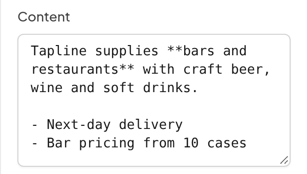

# Markdown Control Descriptor

This control provides a text area for Markdown. The content can be saved as Markdown, HTML, or both formats simultaneously.

{: width="300" }

| Property            | Type                            | Description                                                                         |
| ------------------- | ------------------------------- | ----------------------------------------------------------------------------------- |
| `resultType`          | markdown <br>html <br> mixed    | Determines the output format. Default is `mixed`.                                   |

When the resultType is `markdown` or `html`, the control returns a string. For `mixed`, the value is an object containing both `markdown` and `html` properties.

The Site Builder designer removes from the saved HTML whatever can run script: `<script>`, `<iframe>`, event handler attributes and `javascript:` links. Raw HTML that cannot run script is kept. A value that holds HTML only is edited as HTML there, not converted to Markdown.

In a theme file, a translatable `markdown` setting translated into several languages holds one string per language: its HTML, or its Markdown when resultType is `markdown`.

## Example


<div class="grid" markdown>

```json
...
    "settings": [
        {
            "id": "content",
            "label": "Content",
            "type": "markdown",
            "resultType": "mixed"
        },
        ...
    ]
```

```json
{
    "content": [
        {
            "type": "markdown-example",
            "content": {
                "markdown": "## Markdown example",
                "html": "<h2>Markdown example</h2>"
            }
        }
    ] 
}
```

</div>

<br>
<br>
********

<div style="display: flex; justify-content: space-between;">
    <a href="../images">← Images </a>
    <a href="../menu">Menu →</a>
</div>