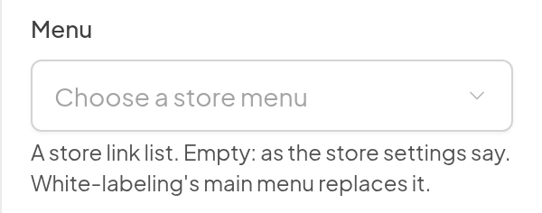

# Menu Control Descriptor

This control picks one of the store's link lists by its name. The list shows every link list of the store with the languages it exists in; the storefront then shows the list in the current language.

{: width="300" }

The value is the link list's name. A name that the store does not have is listed as it is, so it can be replaced. When white-labeling replaces the menu, the field says so.

| Property | Type   | Description                                      |
| -------- | ------ | ------------------------------------------------ |
| `info`   | string | A hint under the field, for example what an empty value means. |

## Example

```json
...
    "settings": [
        {
            "id": "catalog_menu",
            "label": "Menu",
            "type": "menu",
            "info": "A store link list. Empty: as the store settings say."
        },
        ...
    ]
...
```


<br>
<br>
********

<div style="display: flex; justify-content: space-between;">
    <a href="../markdown">← Markdown </a>
    <a href="../number">Number →</a>
</div>
