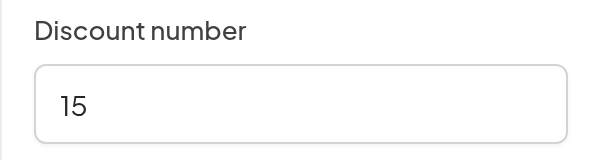

# Number Control Descriptor

This control allows input of numeric values with optional constraints such as minimum, maximum, and step size. A value outside `min` and `max` is set to the nearest limit when the field loses focus.

{: width="300" }

| Property | Type    | Description                                                  |
| -------- | ------- | ------------------------------------------------------------ |
| `min`      | number  | Minimum allowed value.                                       |
| `max`      | number  | Maximum allowed value.                                       |
| `step`     | number  | Increment step for value changes.                            |

## Example
### Numeric input field

```json
...
    "settings": [
        {
            "id": "amount",
            "type": "number",
            "label": "Amount",
            "min": 10,
            "max": 50,
            "step": 5
        },
        ...
    ]
...
```


### Slider control

The `slider` type takes the same properties and is shown as the same numeric input field.

```json
...
    "settings": [
        {
            "id": "amount",
            "type": "slider",
            "label": "Amount",
            "min": 10,
            "max": 50,
            "step": 5
        },
        ...
    ]
...
```

<br>
<br>
********

<div style="display: flex; justify-content: space-between;">
    <a href="../menu">← Menu </a>
    <a href="../object">Object →</a>
</div>