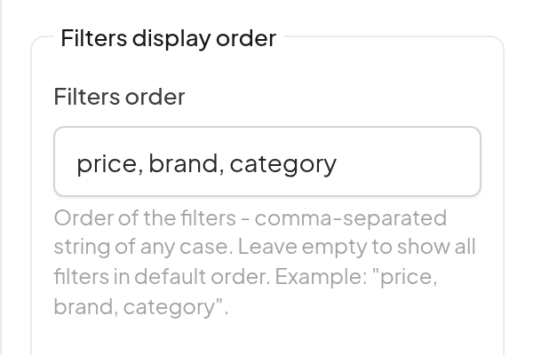

# Object Control Descriptor

This control allows you to edit complex objects composed of multiple fields. You define the object editor inline using the `element` property. The fields are shown as a group under the title. Site Builder reads the fields from `element` only: it does not resolve descriptors of the `objects` folder.

{: width="300" }

| Property            | Type                 | Description                                                         |
| ------------------- | -------------------- | ------------------------------------------------------------------- |
| `title`             | string               | Title of the object editor. Without it, the `label` is shown.       |
| `element`           | ControlDescriptor\[] | List of descriptors that define the object’s fields inline.         |

## Example

```json
...
    "settings": [
        {
            "id": "button",
            "label": "Describe a button",
            "type": "object",
            "title": "The button",
            "element": [
                {
                    "id": "caption",
                    "type": "string",
                    "label": "Caption"
                },
                {
                    "id": "action",
                    "type": "select",
                    "label": "onClick action",
                    "default": "popup",
                    "options": [
                        { "label": "Show popup", "value": "popup" },
                        { "label": "Go to link", "value": "url" }
                    ]
                },
                {
                    "id": "url",
                    "type": "string",
                    "label": "Enter link",
                    "visibility": "!!this.item && this.item.action === 'url'"
                }
            ]
        },
        ...
    ]
...
```

**Result**:

```json
{
    "button": {
        "caption": "Buy now!",
        "action": "url",
        "url": "https://virtocommerce.com"
    }
}
```


<br>
<br>
********

<div style="display: flex; justify-content: space-between;">
    <a href="../number">← Number </a>
    <a href="../paragraph">Paragraph →</a>
</div>