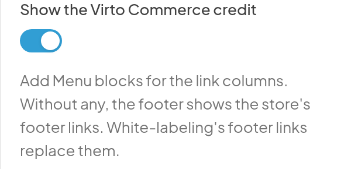

# Paragraph Control Descriptor

This control displays a static block of text in the editor panel. It's typically used to provide additional instructions or context for other controls.

{: width="300" }

| Property | Description                          |
| -------- | ------------------------------------ |
| `label`  | Text to display in the editor panel. |
| `info`   | Text to display when there is no `label`. |

## Example

```json
...
    "settings": [
        {
            "type": "paragraph",
            "label": "Please upload image of reasonable size"
        },
        ...
    ]
...
```

<br>
<br>
********

<div style="display: flex; justify-content: space-between;">
    <a href="../object">← Object </a>
    <a href="../_search">Search →</a>
</div>