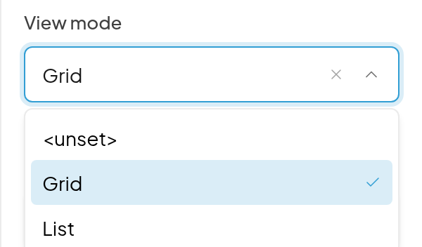

# Select Control Descriptor

This control presents a dropdown list of options to the user. This control supports static options or options fetched from a server.

{: width="300" }

## Descriptor properties

| Property          | Type             | Description                                                                                                                                            |
| ----------------- | ---------------- | ------------------------------------------------------------------------------------------------------------------------------------------------------ |
| `options`         | OptionModel[]  | Array of static options to display in the dropdown.<br>Ignored if `request` is defined.                                                                 |
| `request`         | OptionsRequest | Configuration to fetch options via a web request.<br>The `label` property from the result will be used for display,<br>and the option's value is taken from the `value` field. |
| `searchable`      | boolean        | Lets the user type to filter the options.<br>A select with `request` is always searchable: the typed text goes to the request as `{{__searchQuery}}`. |
| `required`        | boolean        | The value cannot be cleared. The server refuses a theme file with an empty value; a value left out passes when the setting has a `default`.             |

In theme files, such as templates, the server checks that the value of a select with static `options` is one of their values.


## Supporting Types

The following types define the structure of values used within the select control — including individual options and how options are loaded from a server.

### OptionModel

Defines the shape of a single dropdown option:

| Property | Type     | Description         |
| -------- | -------- | ------------------- |
| `label`  | string   | Text shown in UI    |
| `value`  | any      | Option's value      |


### OptionsRequest

Defines the request and which parts of the server response should be used as labels and values for the select options:

| Property   | Type     | Description                              |
| ---------- | -------- | ---------------------------------------- |
| `url`      | string   | Request URL. `{{path}}` placeholders are filled from the context: `location.params.storeId` (the store), `settings` (the page settings, such as `settings.cultureName`), `model` (the values of the section or block), `section`, `block` and `page`. |
| `method`   | string   | `get` (default) or `post`.               |
| `body`     | object   | Request body, with placeholders filled as in `url`. |
| `response` | object   | `result` is a dotted path to the options in the response, such as `data.categories.items`. |
| `label`    | string | Field name used for displaying the label |
| `value`    | string | Field name used for the value. Without it, the whole option object is the value. |

On the platform, a request can only be `GET /api/site-builder/search` or a `POST /graphql` query that reads data. See [Schemas](../contracts/preview-protocol.md#schemas) in the preview protocol.


## Examples

### Basic select

```json
...
    "settings": [
        {
            "id": "theme",
            "type": "select",
            "label": "Theme",
            "placeholder": "Please select theme",
            "options": [
                { "label": "Base", "value": "base" },
                { "label": "Red", "value": "red" },
                { "label": "Green", "value": "green" },
                { "label": "Blue", "value": "blue" }
            ]
        },
        ...
    ]
...
```

### Server request

```json
...
    "settings": [
        {
            "id": "category",
            "label": "Choose category",
            "type": "select",
            "default": null,
            "request": {
                "url": "/graphql",
                "method": "post",
                "body": {
                    "query": "{categories(storeId:\"{{location.params.storeId}}\",cultureName:\"{{settings.cultureName}}\",first:50){items{id,name}}}"
                },
                "response": {
                    "result": "data.categories.items"
                },
                "label": "name",
                "value": "id"
            }
        },
        ...
    ]
...
```

<br>
<br>
********

<div style="display: flex; justify-content: space-between;">
    <a href="../_search">← Search </a>
    <a href="../string">String →</a>
</div>