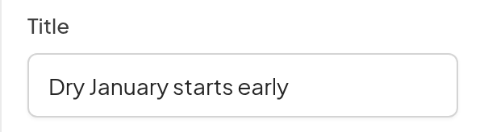

# String Control Descriptor

This control is used to input short or long text values. You can configure it to allow single-line or multi-line input.

{: width="300" }

| Property  | Type    | Default | Description                             |
| --------- | ------- | ------- | --------------------------------------- |
| `multiline` | boolean | `false` | Allows entering text in multiple lines. |
| `format`    | string  |         | `url` marks a link. Such a field is edited in the settings panel only, not in the preview, and the server refuses links in it that run script, such as `javascript:`, and `data:` links. |

## Example


```json
...
    "settings": [
        {
            "id": "title",
            "type": "string",
            "label": "Title",
            "placeholder": "Please enter title"
        },
        {
            "id": "message",
            "type": "string",
            "label": "Message",
            "placeholder": "Please enter message",
            "multiline": true
        },
        {
            "id": "link",
            "type": "string",
            "label": "Link",
            "format": "url"
        },
        ...
    ]
...
```

<br>
<br>
********

<div style="display: flex; justify-content: space-between;">
    <a href="../select">← Select </a>
    <a href="../text">Text →</a>
</div>