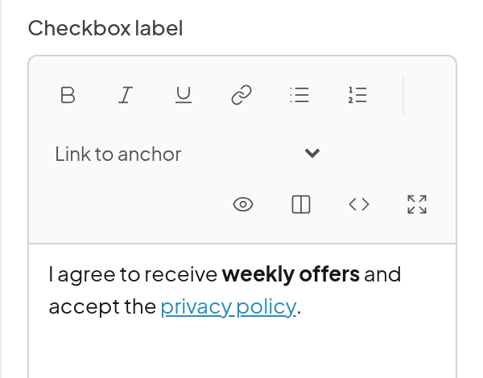

# Text Control Descriptor

This control provides a rich-text editor. It allows users to format text using a WYSIWYG interface. The toolbar has bold, italic, underline, link, bulleted list and numbered list buttons. The value is HTML.

{: width="300" }

## Example

```json
...
    "settings": [
        {
            "id": "caption",
            "type": "text",
            "label": "Caption",
            "default": "Lorem ipsum"
        },
        ...
    ]
...
```

## Page-wide anchor links

The editor's toolbar has a **Link to anchor** list with every anchor on the page being edited:

* the [`anchor` setting](../schemas.md#the-anchor-setting) of each section and block, falling back to
  the generated item id;
* in-text anchors in the HTML of their settings: `<a name="...">` and element ids.

Each entry is listed as `<item name> (#<anchor>)` — the name comes from the schema's `displayField`,
falling back to the schema `name`. Hidden sections and blocks are left out, because the storefront
does not render them, and so is the content of shared components. Picking an anchor links the
selected text to a plain `#anchor` href, which opens in the same tab. The list is shown only when the
page has anchors.


<br>
<br>
********

<div style="display: flex; justify-content: space-between;">
    <a href="../string">← String </a>
</div>