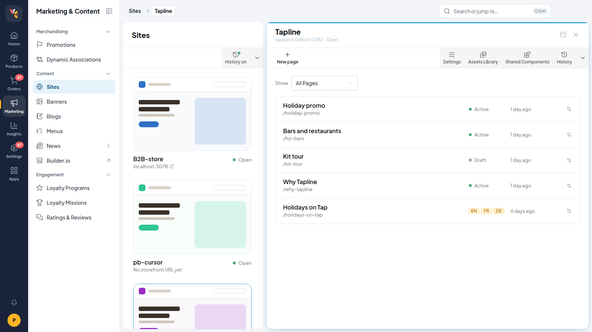
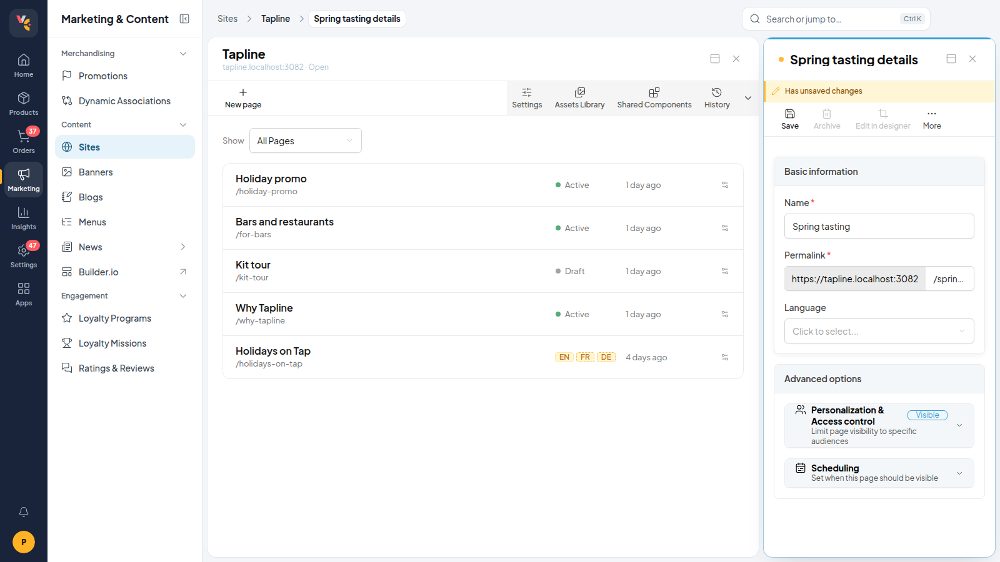
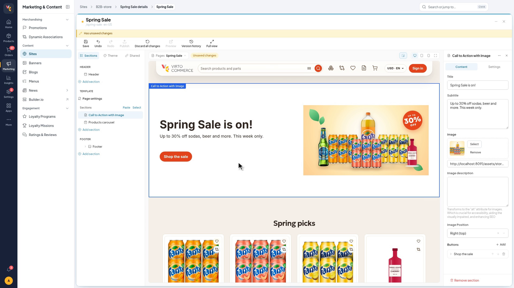

# Getting Started

This guide sets up Site Builder on a Virto Commerce platform with the Virto Frontend and creates a first landing page.

## Prerequisites

* Virto Commerce platform with the Site Builder module and the modules it depends on (listed in its `module.manifest`). See [Modules installation](https://docs.virtocommerce.org/platform/user-guide/modules-installation/).
* Virto Frontend (vc-frontend) with the theme snapshot and preview protocol 2, and `"site_builder_enabled": true` in `client-app/config/settings_data.json`. See [Frontend deployment](https://docs.virtocommerce.org/storefront/developer-guide/deployment/).
* The Pages module (`VirtoCommerce.Pages`), so the storefront finds database pages by their address. It is optional for the designer itself.

## Set up the preview

The designer shows the storefront in a frame, at the store's address followed by `/designer-preview`.

1. Give the store its storefront address: in the store's settings, fill in its URL (or secure URL). The global setting `SiteBuilder.General.StoreUrl` overrides it for every store, and `SiteBuilder.General.StorePreviewPath` changes the path.
1. Let the platform frame the storefront. The storefront sends this header, with the platform's address:

    ```http
    Content-Security-Policy: frame-ancestors 'self' https://<platform>
    ```

## Create a page

=== "Admin Shell"

    1. In the main menu, open **Marketing → Sites** and select the store. The store's pages are listed with their status and languages.

        {: style="display: block; margin: 0 auto;" }

    1. Click **New page** in the toolbar.
    1. Fill in **Name** and **Permalink**, and optionally a **Language**. Under **Advanced options**, **Personalization & Access control** limits who sees the page, and **Scheduling** sets when it is visible.

        {: style="display: block; margin: 0 auto;" }

    1. Click **Save**, then **Edit in designer**. The page opens in the designer with the store's header and footer.

    The store's **Site Builder** widget, in the store's details, opens the same list. There, **Add** creates a Landing Page, or a [Multilanguage Page](multilanguage-pages.md) when the store has more than one language.

=== "Classic Manager"

    1. In the main menu, open **Content**, find the store, and click the **Pages** widget.
    1. Click **Add** in the toolbar and select **Design page**.
    1. Fill in the file name, the language and the permalink, and click **Create**.

    The page is stored as a file, and the designer opens it in a new tab. The store's **Site Builder** widget opens the designer for the store.

## Edit and publish

{: style="display: block; margin: 0 auto;" }

* **Sections** lists the page's sections between the header and the footer. **Add section** adds one; selecting a section opens its settings on the right, with **Content** and **Settings** tabs. Sections can be copied, pasted, hidden and reordered.
* The header and footer are edited in the same list. **Theme** edits the theme settings, logos and palettes; **Shared** lists the Shared Components to place on the page.
* **Save** keeps the changes as a draft, which the preview shows. **Publish** puts the draft live, **Preview** opens it on the storefront, and **Version history** restores an earlier version.

Read more: [Multilanguage Pages](multilanguage-pages.md), [Version history](version-history.md).


<br>
<br>
********

<div style="display: flex; justify-content: space-between;">
    <a href="../index">← Site Builder overview </a>
    <a href="../create-new-block">Creating new block →</a>
</div>
