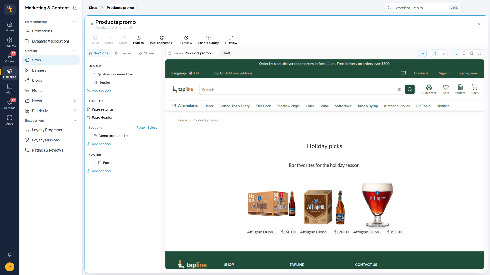
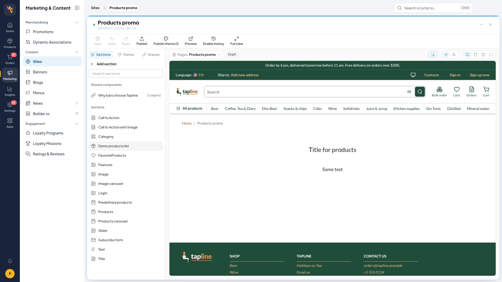
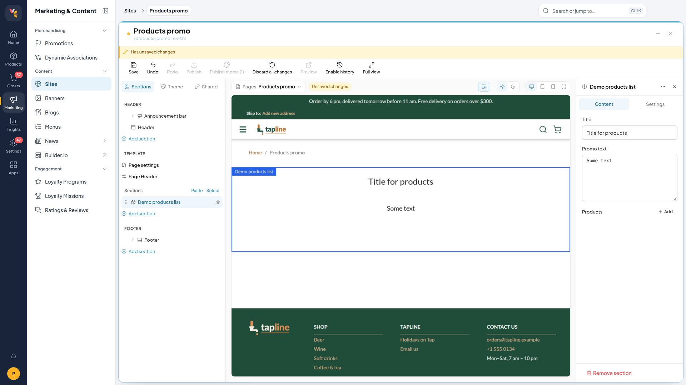
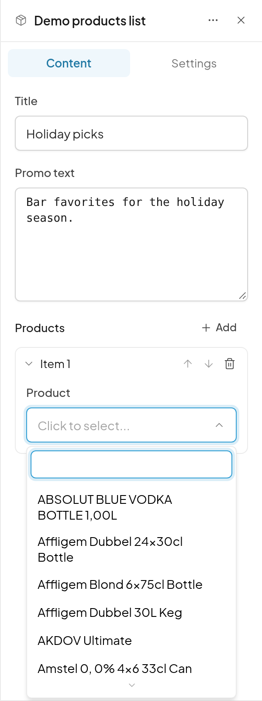

# Create new block

This tutorial will show you how to create a new block. We are going to create a simple block that displays selected products on the frontend.



!!! note
    Virto Frontend already contains the result of this tutorial: the **demo-product-list.vue** component, registered in **index.ts**, and the **__demo-product-list.json** descriptor. The storefront does not load a descriptor whose file name starts with `__`, so the block is not offered until you create **demo-product-list.json**.


## Create block descriptor

Every block starts with a descriptor file. This is a JSON file that defines the block’s structure, behavior, and settings. Descriptor files are located at the following path: **vc-frontend/blob/dev/client-app/plugins/builder-preview/schemas/sections/block-alias.json**. The file name is the block type. The storefront loads every descriptor in this folder, so the file needs no registration.

Let's name our block **demo-product-list** and create a file called **demo-product-list.json**, with the following content:

```json title="demo-product-list.json"
{
  "name": "Demo products list",
  "icon": "inventory_2",
  "displayField": "name",
  "settings": [
    {
      "id": "title",
      "label": "Title",
      "type": "string",
      "default": "Title for products"
    },
    {
      "id": "content",
      "label": "Promo text",
      "type": "markdown",
      "resultType": "markdown",
      "default": "Some text"
    }
  ]
}
```

At this stage, we’ve added two settings fields. Additional properties will be added later.

## Add block to template descriptor

Since frontend can include multiple templates, we need to specify which templates our block can be used with. A template offers the sections listed in the **sections** array of its descriptor. A template descriptor without that array offers every section that has no `targetTemplates` or names the template there.

The descriptor of content pages, **vc-frontend/blob/dev/client-app/plugins/builder-preview/schemas/theme/templates/page.json**, has no **sections** array, and our block has no `targetTemplates`, so every page offers it already.

To offer the block on the product template too, open the file located at
**vc-frontend/blob/dev/client-app/plugins/builder-preview/schemas/theme/templates/product.json**, and include our block in the **sections** array. In Site Builder this file overrides **schemas/templates/product.json**.

```json title="product.json"
{
  ...
  "sections": [
    ...
    "demo-product-list"
  ]
  ...
}
```

## Add block layout

The layout defines the HTML structure and logic for our block. Since we use a Vue.js-based solution, the layout should be implemented as a Vue component.

1. Create a new **vc-frontend/blob/dev/client-app/shared/static-content/components/demo-product-list.vue** file with the following content. A `model` prop gets the whole block with its settings:


    ```vue title="demo-product-list.vue"
    <template>
    <div class="pt-6 pb-16">
        <div class="w-full max-w-screen-2xl mx-auto px-5 md:px-12">
        <h2 class="text-2xl">{{ model.title }}</h2>
        <div class="text-lg">
            <VcMarkdownRender :src="model.content" class="text-gray-500"></VcMarkdownRender>
        </div>
        </div>
    </div>
    </template>

    <script setup lang="ts">
    defineProps({
    model: {
        type: Object,
        required: true,
    },
    });
    </script>
    ```

1. Register the new block in the frontend. Open the **vc-frontend/blob/dev/client-app/shared/static-content/components/index.ts** file and add the following lines. The key is the block type, the name of the descriptor file:

    ```ts title="index.ts"
    ...
    import DemoProductList from "./demo-product-list.vue";

    export const templateBlocks: { [key: string]: Component } = {
    ...
    "demo-product-list": DemoProductList,
    };
    ...
    ```

1. Make sure Site Builder is switched on in **vc-frontend/blob/dev/client-app/config/settings_data.json**. The theme ships with `false`, and without `true` the storefront does not work with the Site Builder designer:

    ```json title="settings_data.json"
    {
      "settings": {
        ...
        "site_builder_enabled": true,
        ...
      }
    }
    ```

1. Recompile the Frontend application by running:

    ```bash
    yarn run build
    ```

## Add block to page

The designer reads the sections from the storefront it previews: when the preview loads, the storefront sends its schemas to the designer. The block is offered once the rebuilt theme runs in the store.

To add the newly created block to a page:

1. Create a new **products-promo** page as described [here](create-landing-page.md).

1. Add your block to the page: click **Add section** and select **Demo products list**. When you point at a section in the list, the preview shows it with its default values.

    

After adding the block, it will be visible in the preview area, and its settings open on the right.



# Add product property to block

To make the block display specific products, we need to update its settings to include a product selection field. 

Open the block settings file and add the following configuration to the **settings** array:

```json
{
  ...
  "settings": [
    ...
    {
      "id": "products",
      "label": "Products",
      "type": "list",
      "default": [],
      "displayField": "product.name",
      "element": [
        {
          "id": "product",
          "label": "Product",
          "type": "select",
          "request": {
            "url": "/graphql",
            "method": "post",
            "body": {
              "operationName": null,
              "variables": {},
              "query": "{products(storeId:\"{{location.params.storeId}}\",cultureName:\"{{settings.cultureName}}\",currencyCode:\"USD\"){items{id,code,name,imgSrc,prices{currency,list{formattedAmount}}}}}"
            },
            "cacheable": true,
            "response": {
              "result": "data.products.items"
            },
            "label": "name"
          }
        }
      ]
    }
  ]
}
```

The query takes the store from `location.params.storeId` and the page's language from `settings.cultureName`: xAPI returns prices only for a language and a currency. See [Select](controls/select.md) for the other placeholders.

We can select products from the list. The request names no `value`, so the setting stores the whole product, which the layout below reads.

{: width="300" }

## Configure products list layout

To visually display the selected products, we need to update the block layout with the following markup:

```vue
<div class="flex flex-row justify-center space-x-4">
  <div v-for="item in model.products" :key="item.product?.id" :product="item">
    <div v-show="item.product" class="flex flex-col w-48">
      <VcImage
        :src="item.product.imgSrc"
        :alt="item.product.name"
        size-suffix="md"
        class="w-full h-full rounded object-cover object-center select-none space-x-4"
      />
      <div class="flex flex-row space-x-4">
        <div class="grow truncate">{{ item.product.name }}</div>
        <div class="whitespace-nowrap">{{ item.product.prices[0].list.formattedAmount }}</div>
      </div>
    </div>
  </div>
</div>
```

<br>
<br>
********

<div style="display: flex; justify-content: space-between;">
    <a href="../create-landing-page">← Getting started </a>
    <a href="../block-library">Block library →</a>
</div>