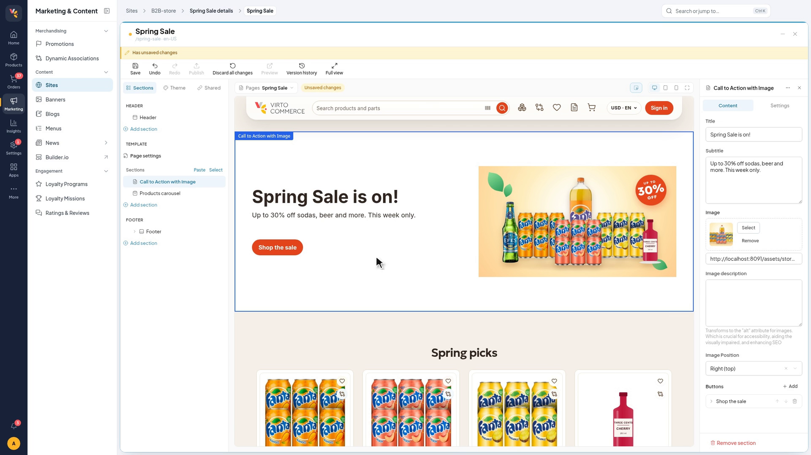
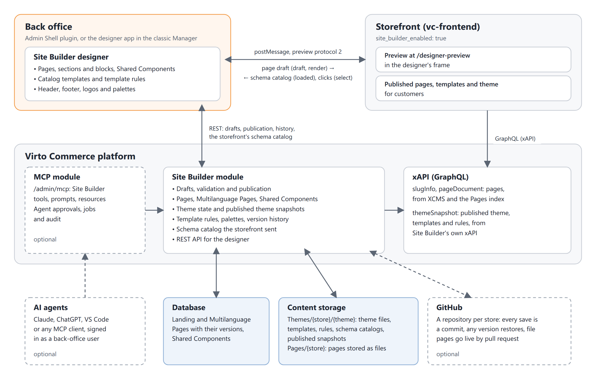

# Virto Commerce Site Builder

The Virto Commerce Site Builder lets business users build storefront pages, catalog templates and the theme in a visual designer, next to a live preview of the real storefront. A page is a list of sections, each with its own settings and blocks, stored as JSON.

Site Builder offers the following benefits:

* For business users:
    * Fast landing page creation with a visual editor.
    * Content preview exactly as seen by customers.
    * Mobile optimization by default.
    * Ready-to-use sections and blocks.

* For developers:
    * Sections and blocks defined by JSON schemas in the storefront theme.
    * Pages, templates and theme served to the storefront through xAPI.
    * Version history and publication through GitHub.
    * A REST API, and tools for AI agents through the MCP module.

## Key features
- Visual landing page creation without developer involvement.
- [Multilanguage pages](multilanguage-pages.md): one page with a version per store language, language switch to the translated permalink, and `hreflang`.
- Catalog templates for products, categories and pages, chosen by template rules.
- Theme editor for the header, footer, logos and the light and dark palettes, with a palette generator that keeps WCAG 2.2 AA contrast.
- [Version history](version-history.md) with preview and one-click rollback, for stores whose pages are kept in git ([Sites on GitHub](sites-on-github.md)).
- eCommerce-focused page customization with real-time previews.
- Mobile responsiveness built in by default.
- SEO settings per page.
- Drag-and-drop section management, including copy, paste, hide, and reorder actions.
- Native integration with the Virto Frontend.
- [AI Assistant](ai-assistant.md) and AI agents through the MCP module.
- Fine-grained permissions, limited to selected stores where needed.

## Architecture

Site Builder has three parts:

- **The designer** runs in the back office (an Admin Shell plugin, and a separate app for the classic Manager). It edits pages, templates and the theme, and saves them to the platform.
- **The platform module** keeps pages, templates and theme drafts, validates them, publishes them, and keeps their version history.
- **The storefront** (vc-frontend) shows the designer's preview in a frame and renders the published pages, templates and theme for customers.

The designer and the storefront's preview talk through `window.postMessage()`, as the [preview protocol](contracts/preview-protocol.md) describes: the designer sends the page being edited, and the storefront sends back its schema catalog, the sections and blocks it can render. Published content reaches the storefront through xAPI; the theme comes as a [theme snapshot](contracts/theme-snapshot.md).

{: style="display: block; margin: 0 auto;" }

[Source code](https://github.com/VirtoCommerce/vc-module-site-builder/) · [Latest release](https://github.com/VirtoCommerce/vc-module-site-builder/releases)

 
 
********

    
    <a href="../create-landing-page">Getting started →</a>

